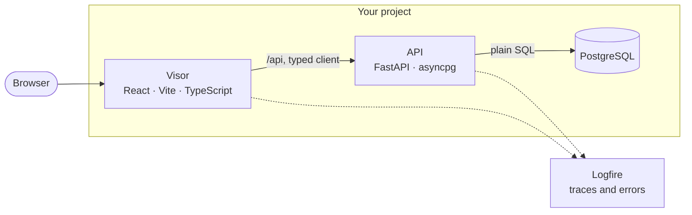
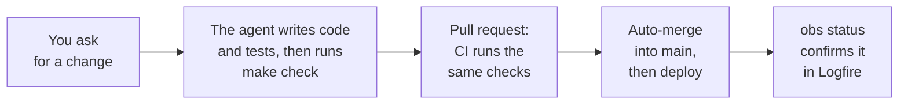

<div align="center">

# full-stack-blueprint

**A Python + React web project, ready in minutes and built for coding agents.**

FastAPI · PostgreSQL · React · TypeScript, with tests, CI and deploy config included.

[](https://github.com/ebotiab/full-stack-blueprint/actions/workflows/ci.yml)
[](https://github.com/ebotiab/full-stack-blueprint/tags)
[](https://github.com/copier-org/copier)
[](LICENSE)

</div>

> [!TIP]
> **See the result before you start.**
> [**full-stack-blueprint-example**](https://github.com/ebotiab/full-stack-blueprint-example) is a
> project generated from this template with every default answer except one, `auth=sessions`, so
> that it also shows the optional sign-in. It is regenerated after every change here. Browse its
> code, its README and its passing CI to see exactly what you will get.

## At a glance

| Part | What you get |
| --- | --- |
| 🐍 **API** | FastAPI on Python 3.14, plain SQL with asyncpg, SQL migrations and a small CLI |
| ⚛️ **Visor** *(optional)* | React 19, Vite and TypeScript, with a client typed from the API |
| 🐘 **Database** *(optional)* | PostgreSQL 18 in Docker on your machine, Neon in production |
| ✅ **Checks** | Format, lint, types, tests against a real database and browser tests, all in one `make check` |
| 🚀 **Deploy** | Render (default), FastAPI Cloud, Railway or Vercel for the API; Vercel for the visor |
| 🤖 **Agents** | An `AGENTS.md`, skills and commands that never ask, for Claude Code, Codex, Cursor… |

## Quick start

You need [uv](https://docs.astral.sh/uv/), [Node 26](https://nodejs.org) and
[Docker Desktop](https://docs.docker.com/get-docker/) running. First time setting up a computer?
Follow the [step-by-step guide](#create-your-project-step-by-step) instead.

```bash
uv tool install copier                              # once per computer
copier copy gh:ebotiab/full-stack-blueprint my-app  # Enter keeps each default
cd my-app
git init -b main && git add -A && git commit -m "Generate from full-stack-blueprint"
make setup   # dependencies, database, migrations, API types
make dev     # API on :8000, visor on :5173
```

Open http://127.0.0.1:5173: the app is running. `make check` runs everything the CI runs.

## How it fits together

What runs:



How a change reaches production:



## Built for development with coding agents

You direct the work and a coding agent writes most of the code. Every choice follows from that:
code an agent can read and verify beats abstraction that saves a person typing, and every check
gives a clear verdict the agent can act on without asking.

| Choice | Why it helps |
| --- | --- |
| **SQL, no ORM** | Queries are plain SQL run with asyncpg, next to the code that uses them, and a schema change is a numbered `.sql` file. An ORM saves people from writing SQL; for an agent that work is cheap, while an ORM adds a second language and queries generated out of sight. |
| **Contracts that machines check** | Types on both sides, an OpenAPI schema committed with the code, TypeScript types generated from it and tests against a real PostgreSQL. When any of them drifts the CI fails, so a mistake shows up as a failed check instead of a bug in production. |
| **Commands that never ask** | Every `make` target runs without prompts and ends with a reliable exit code and a summary of what passed and failed. |
| **Instructions in the repository** | Each project has an `AGENTS.md` (Claude Code reads it through `CLAUDE.md`; Codex, Cursor and others read it directly) and skills for its usual tasks, such as changing the API or shipping a change. |
| **Production the agent can check** | `obs status` reads the traces in Logfire and tells whether a commit is deployed and serving without errors, so a task ends when production confirms it. |

## What's inside

A project generated with the defaults, here called `my-app`:

```text
my-app/
├── AGENTS.md              instructions for coding agents (CLAUDE.md points here)
├── Makefile               setup · dev · check · fmt · types · migrate …
├── .agents/skills/        step-by-step tasks for agents: change the API, ship a change
├── backend/               the API
│   ├── src/my_app/
│   │   ├── api/           FastAPI app and routes
│   │   ├── db/            connection pool, migration runner, migrations/*.sql
│   │   ├── cli.py         migrate · openapi · obs status
│   │   └── settings.py    configuration from environment variables
│   ├── tests/             pytest, against a real PostgreSQL
│   └── openapi.json       the API contract, committed with the code
├── frontend/              the visor (optional)
│   ├── src/api/           client typed from openapi.json
│   └── e2e/               Playwright browser tests
├── docker-compose.yml     local PostgreSQL (optional)
├── render.yaml            deploy config for the chosen target
└── .github/               CI and Dependabot
```

<details>
<summary><b>The full stack, piece by piece</b></summary>

- **API** (`backend/`): Python 3.14 with uv and uv_build, FastAPI, asyncpg without an ORM and a
  small packaged SQL migration runner (idempotent, PostgreSQL advisory lock, checksums),
  pydantic-settings, a Typer CLI (`migrate`, `openapi`, `obs status`), Logfire (works without a
  token), pytest against a real PostgreSQL, ruff, and pyright or ty. Optional sign-in
  (`auth: sessions`): accounts, session cookies and API keys in PostgreSQL, with pwdlib (Argon2id).
- **Visor** (`frontend/`, optional): Vite 8, React 19, TypeScript 7, a client typed from the API's
  OpenAPI schema (`openapi-typescript` + `openapi-fetch`), oxlint with type-aware rules, oxfmt
  (exact version), Vitest,
  Playwright, `@pydantic/logfire-browser` and Vercel Web Analytics.
- **Database** (optional): PostgreSQL 18 in docker-compose for development; Neon in production.
- **Deploy**: the API on Render (default), FastAPI Cloud, Railway or Vercel; the visor on Vercel.
  Only the chosen target's files are generated, in an EU region wherever the platform has one.
- **Repository**: a CI that skips the half a pull request does not touch and fails when the
  OpenAPI schema or the generated types are stale, workflows audited by zizmor, grouped
  Dependabot updates, a 7-day wait before any new release is installed (Dependabot, uv, npm),
  VS Code settings that match the checks.

</details>

## Create your project, step by step

From an empty computer to a project that runs on your machine, lives in its own GitHub repository
and passes all its checks. The first time takes about half an hour, mostly installing tools. You
need no cloud account until you deploy.

### 1. Install the tools (once per computer)

| Tool | What it does | How to install | Needed for |
| --- | --- | --- | --- |
| **git** and **make** | Keeps your code's history; runs the project's tasks | macOS: `xcode-select --install`<br>Ubuntu/Debian: `sudo apt install git make` | every project |
| **uv** 0.9.17+ | Runs Python and installs its packages; it downloads the right Python by itself | `curl -LsSf https://astral.sh/uv/install.sh \| sh`<br>or `brew install uv` | every project |
| **Copier** 9.8+ | Generates the project from this template | `uv tool install copier` | every project |
| **Node 26 LTS** (npm 11.10+) | Runs the visor's tools | [nodejs.org](https://nodejs.org), `brew install node@26` or `nvm install 26` | the visor |
| **Docker Desktop** | Runs the local PostgreSQL; start it once after installing | [docs.docker.com/get-docker](https://docs.docker.com/get-docker/) | the database |
| **GitHub CLI** | Creates the repository from the terminal | `brew install gh` or [cli.github.com](https://cli.github.com), then `gh auth login` | optional |
| **A coding agent** | Writes code with you | [Claude Code](https://claude.com/claude-code), Codex, Cursor… | recommended |

> [!NOTE]
> **On Windows**, install [WSL 2](https://learn.microsoft.com/windows/wsl/install) with Ubuntu,
> turn on Docker Desktop's WSL 2 integration and run every command of this guide inside Ubuntu:
> the `Makefile` and the scripts need bash.

To see that everything is in place, `git --version`, `uv --version`, `copier --version`,
`node --version` and `docker info` should each print a version or a status, not an error.

### 2. Decide your answers

Every question has a default ([see them all](#options-and-defaults)). These are worth a thought:

| Question | Example | What it decides |
| --- | --- | --- |
| `project_name` | `Bus Stops` | The readable name. The short names come from it: `bus-stops` for the repository and commands, `bus_stops` for the Python package. |
| `github_repo` | `your-user/bus-stops` | The repository you create in step 4. It does not need to exist yet. |
| `with_frontend`, `with_database` | `true` | Keep both unless you want an API without a visor or without PostgreSQL. |
| `api_deploy` | `render` | Where the API runs in production. |

You can change any answer later: see [Update a project](#update-a-project).

### 3. Generate the project

From the folder where you keep your projects:

```bash
copier copy gh:ebotiab/full-stack-blueprint bus-stops
```

Copier asks each question with its default: press Enter to keep it.

<details>
<summary>Without questions (what agents do)</summary>

Take the defaults and override what you need:

```bash
copier copy --defaults \
  --data project_name="Bus Stops" \
  --data github_repo=your-user/bus-stops \
  gh:ebotiab/full-stack-blueprint bus-stops
```

Or put the answers in a file:
`copier copy --defaults --data-file answers.yml gh:ebotiab/full-stack-blueprint bus-stops`.
The template has no `_tasks`, so `--trust` is never needed.

</details>

### 4. Put it in git and on GitHub

```bash
cd bus-stops
git init -b main
git add -A
git commit -m "Generate from full-stack-blueprint"
gh repo create your-user/bus-stops --private --source . --push
```

<details>
<summary>Without the GitHub CLI</summary>

Create an empty repository at https://github.com/new (add no README, `.gitignore` or license: the
project brings its own files), then:

```bash
git remote add origin https://github.com/your-user/bus-stops.git
git push -u origin main
```

</details>

### 5. Install and check everything

```bash
make doctor   # checks the tools and says how to fix whatever is missing
make setup    # dependencies, PostgreSQL, migrations, API schema and types
make check    # everything the CI runs: format, lint, types, tests, build, browser tests
```

Each command ends with a summary, one line per step. The first `make check` takes a few minutes;
this is what success looks like:

```text
Summary
  ok    Python format (ruff format) (1s)
  ok    Python lint (ruff check) (0s)
  ok    Python types (pyright) (2s)
  …
  ok    Visor browser tests (Playwright) (5s)
All 12 steps passed.
```

Then save what `make setup` generated (lockfiles, API schema and types):

```bash
git add -A && git commit -m "Lockfiles and generated API types" && git push
```

### 6. Run it

```bash
make dev
```

| What | Where |
| --- | --- |
| The visor | http://127.0.0.1:5173 |
| The API | http://127.0.0.1:8000/api (try http://127.0.0.1:8000/api/healthz) |
| Interactive API docs | http://127.0.0.1:8000/docs |

Ctrl-C stops everything.

### 7. Work with a coding agent

Open the project folder with your agent (for Claude Code, run `claude` inside it) and ask for a
change in plain words, for example:

> Add an endpoint that lists bus stops near a point, with its table and migration.

The agent reads `AGENTS.md`, which has the layout, the commands and the conventions, and the
skills in `.agents/skills/` for usual tasks such as changing the API. The conventions ask it to
write tests, run `make check` and open one small pull request per task, marked to merge itself as
soon as the CI passes; you can review it before then.
[Built for development with coding agents](#built-for-development-with-coding-agents) explains
why it works this way.

### 8. Deploy, when you are ready

Follow the steps for your target in [Manual steps per target](#manual-steps-per-target): a few
one-time accounts and secrets, plus protecting `main` on GitHub so that pull requests merge only
when the CI passes. After that, merging into `main` deploys.

### If something fails

| Symptom | What to do |
| --- | --- |
| `make doctor` reports a problem | Run the fix it prints under the failed line, then run `make doctor` again. |
| The PostgreSQL port is taken (another project uses 5434) | Generate with another port, such as `--data postgres_port=5544`, or follow the fix `make doctor` prints. |
| Docker is installed but nothing starts | Open Docker Desktop and wait until it says it is running. |
| uv or npm cannot find a version that exists | The project only installs releases that are at least 7 days old, as a protection against compromised packages. Use a version that is a week old. |
| `make check` fails | The summary names the step. `make fmt` fixes formatting and `make types` stale API types; for anything else, the output above the summary says what broke. If you work with an agent, give it the summary. |

## Options and defaults

| Question | Default | Values |
| --- | --- | --- |
| `project_name` | `My Project` | any text |
| `project_slug` | from the name (`my-project`) | kebab-case: repository, CLI command, service names |
| `package_name` | from the slug (`my_project`) | Python package, at most 58 characters, not a standard-library module (`calendar`, `email`) |
| `env_prefix` | from the package (`MY_PROJECT_`) | prefix of the project's environment variables |
| `description` | `A FastAPI API with a React visor.` | one sentence |
| `github_repo` | `your-github-user/<slug>` | `owner/name`; used for links, Logfire and Railway |
| `with_frontend` | `true` | include the visor |
| `with_database` | `true` | include PostgreSQL |
| `postgres_port` | `5434` | host port of the local PostgreSQL (asked only with a database) |
| `auth` | `none` | `none`, `sessions` (own accounts in PostgreSQL; needs the database), `oidc` (an external provider's tokens) |
| `type_checker` | `pyright` | `pyright`, `ty` |
| `api_deploy` | `render` | `render`, `fastapi_cloud`, `railway`, `vercel` |
| `api_public_url` | the platform's usual URL | where the visor's `vercel.json` proxies `/api` (asked only with a visor and a non-Vercel API) |

<details>
<summary><b>What <code>auth: sessions</code> adds</b></summary>

Accounts with email and password, browser sessions and API keys, all in the project's PostgreSQL
and in its own code (`backend/src/<package>/auth/`, one migration, no auth service to sign up
for). It follows OWASP ASVS 5.0 and RFC 10017, which recommends a session cookie when the browser
app and the API share an origin, as they do here on every target:

- **Sessions**: an opaque token in a `__Host-` cookie (HttpOnly, Secure, SameSite=Lax), stored as
  a SHA-256 hash; 7 days without use or 30 in total end it; logout deletes it, and a new password
  or a deactivated account ends every session of the user. No secret key to generate or rotate.
- **Passwords**: Argon2id through pwdlib with OWASP's minimum profile, rehashed at login when the
  parameters change; the same answer and the same work for an unknown email and a wrong password;
  ten attempts per account, then one per minute (a token bucket in PostgreSQL, so it also works on
  serverless functions).
- **Cross-site requests**: a request that changes state with the cookie must carry
  `Sec-Fetch-Site: same-origin` (or a listed `Origin` in browsers from before 2023).
- **API keys** for scripts and projects without a visor: `Authorization: Bearer <key>`, created,
  listed and revoked with the CLI, which also creates the accounts (there is no sign-up route).
- **Routes** take `user: CurrentUser` or `AdminUser` (the example `/api/messages` does);
  `tests/test_auth.py` checks every rule above against the real PostgreSQL.
- **Visor**: a sign-in form until `/api/auth/me` answers with a user, and a sign-out button; the
  visor never handles a token. Playwright tests cover the form.

`none` stays the default: a project without accounts carries no security code, and
`copier update --defaults --data auth=sessions` adds it later.

</details>

<details>
<summary><b>What <code>auth: oidc</code> adds</b></summary>

For projects that need what an identity provider sells (SSO and SAML, organizations, MFA with
recovery, passkeys, a ready account UI): the provider owns the accounts and the API verifies its
signed tokens, sent as `Authorization: Bearer`. One verifier fits Auth0, Keycloak, Zitadel, Logto,
Kinde, Pocket ID, Supabase and Neon Auth (and Clerk, through `azp`):

- **Keys** come from the provider's JWKS (found through OpenID discovery unless set), fetched with
  the project's async httpx, cached for an hour and fetched again on an unknown key id at most
  once a minute.
- **Checks**: signature with asymmetric algorithms only (RS256, ES256, EdDSA, which rules out
  HS256 confusion), issuer, expiry with 30 seconds of leeway, and audience and authorized party
  when set. Settings are `<PREFIX>AUTH_ISSUER`, `AUTH_AUDIENCE`, `AUTH_JWKS_URL`,
  `AUTH_ALGORITHMS`, `AUTH_AUTHORIZED_PARTIES` and `AUTH_EMAIL_CLAIM`.
- **Users**: with a database, one row per `(issuer, subject)`, created on first sight; without
  one, `CurrentUser` comes from the claims alone. It works with or without the database.
- **Visor**: sign-in at the provider with the code flow and PKCE (`oidc-client-ts`,
  `react-oidc-context`) and an `openapi-fetch` middleware that sends the access token; the example
  `/api/messages` requires it. The tokens live in `sessionStorage`, readable by any script on the
  page, which is why `sessions` is the first choice for apps with personal data.
- **Tests** run offline: a test key signs the tokens and a fake provider serves its keys; Playwright
  answers the provider's requests itself.

</details>

<details>
<summary><b>What each deploy target generates</b></summary>

| `api_deploy` | Files | Migrations run | Deployed commit read from |
| --- | --- | --- | --- |
| `render` | `backend/Dockerfile`, `render.yaml` | at API start-up (free plan has no pre-deploy) | `RENDER_GIT_COMMIT` |
| `fastapi_cloud` | `[tool.fastapi] entrypoint`, `.github/workflows/deploy-api.yml` | at API start-up | `backend/DEPLOYED_COMMIT`, written by the workflow |
| `railway` | `backend/Dockerfile`, `.railway/railway.ts` | Railway pre-deploy command | `RAILWAY_GIT_COMMIT_SHA` |
| `vercel` | root `vercel.json` (services), `.github/workflows/deploy.yml` with a database | in the deploy workflow, before deploying | `VERCEL_GIT_COMMIT_SHA` |

Every project also reads its own `<PREFIX>COMMIT` first. With a visor, `frontend/vercel.json`
deploys it to Vercel; with `vercel`, visor and API share one project and one domain (`/api`), so
there is no CORS anywhere. API responses carry `Cache-Control: no-store` unless a route sets its
own, and `frontend/vercel.json` sends `x-vercel-enable-rewrite-caching: 0` for `/api`: Vercel
projects created since 2026-04-06 otherwise let its CDN cache what a proxied API returns. Railway
uses `.railway/railway.ts` (Infrastructure as Code) because its `railway.json`/`railway.toml`
format is deprecated and stops being read on 2026-12-01.

</details>

<details>
<summary><b>Defaults and versions that will change</b></summary>

Two defaults, each a one-line edit in `copier.yml` (the comment above the question says which line):

- **`type_checker: ty`** once ty publishes a stable 1.0 release. Until then it is a 0.0.x beta:
  faster than pyright, but its diagnostics still change between releases. Projects on pyright
  meanwhile run ty in an informational CI job ("ty preview") that never fails and lists what ty
  finds in its summary.
- **`api_deploy: fastapi_cloud`** once FastAPI Cloud offers all of: an EU region, a Dockerfile or a
  command that runs before start-up (for migrations), rollbacks that are no longer "coming soon",
  and active usage-based billing. Until then Render is the default: Docker, Frankfurt, a free plan.

Two versions held back until every part of a project can run them:

- **Python 3.15** (released in October 2026) once every deploy target runs it: Vercel's Python
  runtime listed 3.12 to 3.14 in November 2026, and FastAPI Cloud needs the same check. The version
  is written in `backend/pyproject.toml` (`requires-python`, ruff's `target-version` and the type
  checker's version), `backend/.python-version`, the workflows, the Dockerfile's base image and
  the standard-library list in `copier.yml`.
- **PostgreSQL 19** (released on 19 November 2026) once it has its first minor release and Neon
  offers it for new projects. The version is written in `docker-compose.yml` (the image and the
  volume's name) and in the CI's `postgres` service.

One tool to replace:

- **openapi-typescript**, which generates the visor's `schema.d.ts`, has been in maintenance mode
  since 19 September 2026 (no updates, no security fixes). It stays pinned at 7.13.0, run with
  `npx` in its own TypeScript 5. Its successor is **openapi-typesafe**, a fork that presents
  itself as a drop-in replacement ready for TypeScript 7. From its 1.0 release (1.0.0-rc.16 on
  18 November 2026), switch the two `npx` commands in `frontend/package.json` (`types`,
  `types:print`) and run `make types`. For this template's schema its output is already the same
  except for the header comment. The same fork aims to replace `openapi-fetch`, so check that too
  then. `make schema-check` catches any difference in the generated types.

</details>

## Manual steps per target

Generating and checking a project needs no account, and nothing in the template creates cloud
resources. Deploying needs these one-time steps; the generated project's README ("Deploy") repeats
the ones that apply, with its own names filled in.

For every project:

- **Logfire**: create a project; a write token as `LOGFIRE_TOKEN` on the API's platform; a read
  token in `~/.config/<slug>/logfire-read-token` for `obs status`; for browser errors, a frontend
  application's token and regional URL as `VITE_LOGFIRE_TOKEN` and `VITE_LOGFIRE_BASE_URL` in Vercel.
- **Neon** (with a database): a project in an EU region (`aws-eu-central-1`); the direct connection
  string for Render, Railway, FastAPI Cloud and migrations; the pooled one (`-pooler`) for Vercel.
- **GitHub**: protect `main` with the required checks `Backend` and `Frontend`, and allow auto-merge.

Then the steps for your target:

<details>
<summary><b>Render</b> (default)</summary>

New → Blueprint → the repository; set `DATABASE_URL` and `LOGFIRE_TOKEN` when asked.

</details>

<details>
<summary><b>FastAPI Cloud</b></summary>

`fastapi login`, a first `fastapi deploy` from `backend/`, `fastapi cloud setup-ci --secrets-only`
(GitHub secrets `FASTAPI_CLOUD_TOKEN`, `FASTAPI_CLOUD_APP_ID`), and `fastapi cloud env set` for
`DATABASE_URL`, `LOGFIRE_TOKEN` and `<PREFIX>ENVIRONMENT`.

</details>

<details>
<summary><b>Railway</b></summary>

`npm install --prefix .railway`, `railway link`, `railway config apply`; then `DATABASE_URL`,
`LOGFIRE_TOKEN`, a public domain and "Wait for CI" in the dashboard.

</details>

<details>
<summary><b>Vercel</b> (the visor, or the <code>vercel</code> target)</summary>

Import the repository: root `frontend` for the visor alone, the repository root for the `vercel`
target. Set the environment variables `LOGFIRE_TOKEN`, `VITE_LOGFIRE_TOKEN`, `VITE_LOGFIRE_BASE_URL` and, for `vercel` with
a database, `DATABASE_URL` (pooled), plus the GitHub secrets of `deploy.yml` (`DATABASE_URL`
direct, `VERCEL_TOKEN`, `VERCEL_ORG_ID`, `VERCEL_PROJECT_ID`). With a non-Vercel API, check the
API URL in `frontend/vercel.json`.

</details>

## Update a project

Copier remembers the answers in the project's `.copier-answers.yml`. When the template improves:

```bash
cd my-project
git status                                # must be clean
copier update --defaults                  # latest tagged release of the template
copier update --defaults --vcs-ref=HEAD   # or the template's latest commit
make setup && make check
```

Copier merges the template's changes with yours; conflicts appear as inline markers. Changing an
answer is also an update: `copier update --defaults --data api_deploy=railway`.

## Working on the template

The template lives in `template/` (`_subdirectory`); files ending in `.jinja` are rendered, and
names like `frontend` make whole files or folders conditional.

```bash
scripts/check-combination.sh /tmp/fsb-a                                  # defaults: make setup + make check
scripts/check-combination.sh /tmp/fsb-b --data api_deploy=railway --data type_checker=ty
scripts/check-update.sh /tmp/fsb-update                                  # copier update applies cleanly
scripts/check-name-lengths.sh /tmp/fsb-lengths                           # ruff for every name length
```

The CI (`.github/workflows/ci.yml`) runs five combinations that cover every value of every option,
plus the name-length check and the update check, on every pull request and every Monday: a new
release of a dependency can break new projects without any commit here.
Agents working on the template read [AGENTS.md](AGENTS.md).

The example project follows `main`: after every push that changes what the template generates,
`.github/workflows/update-example.yml` runs `scripts/update-example.sh` on a checkout of the
example and opens a pull request there, which merges itself when the example's CI passes. The
script also passes the example's one non-default answer (`auth=sessions`). It
needs the secret `EXAMPLE_REPO_TOKEN` (the workflow's first comment says which token).

## License

[MIT](LICENSE). It covers the template itself; projects generated from it are yours to license as
you wish.
