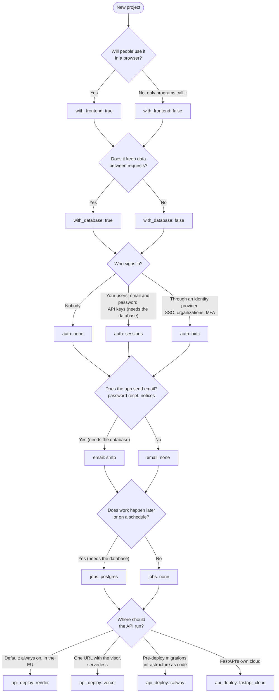

# 🧭 Choosing your options

The template asks a dozen questions, but **only six are decisions**: the visor, the database,
sign-in, email, background jobs and where the API runs. The rest name things (project, package,
repository) or pick a port, and their defaults are fine. The six decisions are few on purpose:
together they cover the projects a Python full-stack developer usually builds, and each one can be
changed later with `copier update` (see [Changing your mind](#-changing-your-mind)).

> [!TIP]
> **In a hurry?** Find your project in the recipes below, copy its flags, and add them to
> `copier copy --defaults --data project_name="…" gh:ebotiab/full-stack-blueprint my-project`.

## 🍳 Recipes: start from the project you have in mind

| I'm building… | Flags | You get |
| --- | --- | --- |
| 🧪 **A prototype, a demo, a first version** | *(none: the defaults)* | Visor + API + PostgreSQL, no accounts, API on Render |
| 🔐 **An internal tool or dashboard** for a team, with login | `--data auth=sessions --data email=smtp` | Accounts with email and password, password reset by email, API keys for scripts |
| 🏢 **A SaaS for companies** that need SSO, organizations or MFA | `--data auth=oidc --data email=smtp` | Sign-in through Auth0, Keycloak, Zitadel… (the provider owns the accounts), outgoing email |
| 🤖 **An API for scripts, services or partners**, no browser UI | `--data with_frontend=false --data auth=sessions` | API only; callers use API keys you create with the CLI |
| 📊 **A public API or open data** that anyone can read | `--data with_frontend=false` | API + PostgreSQL, no accounts |
| ⏱️ **An app that imports, syncs or sends digests on a schedule** | `--data jobs=postgres` | Queued and periodic background jobs in PostgreSQL, with retries |
| 🧮 **A tool that computes but keeps nothing** (calculator, converter, a wrapper around another API) | `--data with_database=false` | Visor + API, no database to run or pay for |
| 🌍 **A hobby or low-traffic app on a single URL** | `--data api_deploy=vercel` | Visor and API in one Vercel project (serverless) |

Recipes combine: an internal tool for scripts and people on one Vercel URL is
`--data auth=sessions --data email=smtp --data api_deploy=vercel`.

## 🌳 Decide step by step



## 🧩 The decisions, one by one

### 🖥️ `with_frontend`: the visor

A Vite + React + TypeScript app in `frontend/`, deployed on Vercel, that calls the API through a
client typed from its OpenAPI schema. **Default: `true`.**

| ✅ Keep it when | ❌ Turn it off when |
| --- | --- |
| People will use the project in a browser | Only programs call the API (scripts, other services, a mobile app with its own repository) |
| You want a typed client and browser tests from day one | Another team or repository owns the UI |

Without it you skip Node, npm and a Vercel project. The API is the same either way.

#### 🎨 `ui`: how the visor is styled (only with the visor)

| | 📄 `css` (default) | 🌬️ `tailwind` |
| --- | --- | --- |
| **What you get** | One small stylesheet, `src/index.css` | Tailwind CSS 4 through its Vite plugin; no config file |
| **How you style** | CSS rules for elements and classes | Utility classes in `className` (`flex gap-4 text-sm`), dark mode with `dark:` |
| **Best for** | Data visors and internal pages with little design | Apps whose UI will grow: consistent spacing and colors, and agents write it fluently |
| **Keep in mind** | Grows harder to keep consistent as screens multiply | One more dev dependency; long class lists if you dislike them |

With `tailwind`, the generated pages keep their markup and get their look from a few base rules in
`src/index.css`; new components use utility classes. Ready components (shadcn/ui) come later,
from its CLI, if the project wants them.

### 🐘 `with_database`: PostgreSQL

PostgreSQL 18 in Docker on your machine and Neon in production, with asyncpg, plain SQL and
numbered migrations. **Default: `true`.**

| ✅ Keep it when | ❌ Turn it off when |
| --- | --- |
| Anything must survive a restart: users, records, settings, history | The API only computes, converts or calls other APIs |
| You may add accounts or email later (both need it) | You want the lightest possible project and will never store data |

Without it there is no Docker, no Neon and no migrations, but also no `auth=sessions` and no
`email=smtp`.

### 🔐 `auth`: who can sign in

| | 🚫 `none` (default) | 🔑 `sessions` | 🏢 `oidc` |
| --- | --- | --- | --- |
| **Who owns the accounts** | Nobody: everything is public | Your database | An identity provider (Auth0, Keycloak, Zitadel, Logto, Neon Auth, Clerk…) |
| **How people sign in** | Nothing to do | Email and password in the visor; API keys for scripts | At the provider's page (SSO, social login, MFA, passkeys: whatever it offers) |
| **Best for** | Public sites and APIs, prototypes | Internal tools, apps for a known group, APIs for scripts | B2B SaaS, companies that require SSO or SAML, apps that need MFA |
| **What you set up** | Nothing | The first admin, with one CLI command | An application at the provider and its issuer URL |
| **Monthly cost** | None | None | The provider's plan (most have a free tier) |
| **Needs the database** | No | Yes | No (with one, users get a row) |
| **Personal data** | — | Stays in your PostgreSQL | Also at the provider |

Rule of thumb: **start with `sessions`** unless a customer requires SSO or MFA. It has no external
service and no monthly bill, and the session lives in a cookie that page scripts cannot read. With
`oidc` the visor holds the provider's token in the browser. Both protect routes the same way
(`user: CurrentUser`), so switching later changes the sign-in screen and the settings, not your
routes.

> [!NOTE]
> There is no public sign-up page: with `sessions` you create accounts with the CLI
> (`users create`). Opening registration is a small change an agent can make when you need it.

### ✉️ `email`: outgoing email

SMTP, so any transactional provider works (Resend, Postmark, Amazon SES, Brevo…). Locally,
Mailpit catches every message and shows it at http://localhost:8025. **Default: `none`.**

| ✅ Choose `smtp` when | ❌ Leave `none` when |
| --- | --- |
| You use `auth=sessions`: it adds password reset with one-time codes | Nobody needs to hear from the app |
| The app must notify people: invitations, receipts, alerts | You only send newsletters: use your provider's marketing tool instead |

It needs the database (Mailpit runs in its docker-compose) and a provider account to deploy.

### ⏱️ `jobs`: background jobs

Jobs and periodic tasks kept in PostgreSQL, run by the API process itself, by a dedicated worker,
or by a scheduled call. No Redis, no queue service. **Default: `none`.**

| ✅ Choose `postgres` when | ❌ Leave `none` when |
| --- | --- |
| Work can fail and must be retried: webhooks, emails, calls to other APIs | Everything finishes within the request |
| Something runs on a schedule: imports, syncs, digests, cleanups | Short best-effort work after the response is enough (FastAPI's `BackgroundTasks`) |
| A request starts work that takes longer than a page should wait | Jobs last hours: use a dedicated worker or queue service from the start |

On Railway the always-on API runs the jobs. On Render, FastAPI Cloud and Vercel a free GitHub
Actions schedule calls the API every 10 minutes, so periodic tasks run within about 10 minutes of
their time (queued jobs still start right after the request). It needs the database.

### 🚀 `api_deploy`: where the API runs

The visor always goes on Vercel and proxies `/api`, so the browser sees a single domain.

| | 🟣 `render` (default) | ▲ `vercel` | 🚂 `railway` | ⚡ `fastapi_cloud` |
| --- | --- | --- | --- | --- |
| **How it runs** | A Docker container, always on (sleeps on the free plan) | Python functions next to the visor, one project and one URL | A Docker container | FastAPI's own platform, deployed from GitHub Actions |
| **Region** | Frankfurt | Frankfurt (`fra1`) | Amsterdam | No EU region yet |
| **Migrations** | At start-up | In a deploy workflow, before the code goes live | Pre-deploy command | At start-up |
| **Best for** | Most projects: simple, EU, free plan to start | Hobby and low-traffic apps; one URL for everything | Teams that want infrastructure as code and pre-deploy steps | Following FastAPI's platform as it matures |
| **Keep in mind** | Free plan: the first request after 15 idle minutes takes about a minute | Cold starts; long jobs and WebSockets do not fit functions | Usage-based billing, no free plan | Rollbacks and some features are still "coming soon" |

Every target has a free or trial way to start, and the deploy files of the others are not generated.

### 🧰 `type_checker`: leave the default

`pyright` (default) matches VS Code's Pylance. `ty` is faster but still a 0.0.x beta. Projects on
pyright already run ty in an informational CI job, and the default switches when ty reaches 1.0.
Pick `ty` only if you want to try it today.

## 🔗 Combinations that do not exist

| Combination | Why |
| --- | --- |
| `auth=sessions` without a database | Accounts and sessions live in PostgreSQL |
| `email=smtp` without a database | Mailpit runs in the database's docker-compose |
| `jobs=postgres` without a database | The jobs live in a PostgreSQL table |

Copier refuses them with a message that says what to change.

## 🧱 What no option covers (yet)

These needs come up often, but they depend too much on the project to be a question. Ask your
agent for them in their own pull request; the project's `AGENTS.md` keeps the change in the
template's style.

| Need | A good start |
| --- | --- |
| File uploads | Object storage (Vercel Blob, Cloudflare R2, S3) with presigned URLs; keep only the key in PostgreSQL |
| Payments | Stripe Checkout and a webhook route that verifies the signature |
| AI features | Pydantic AI; Logfire, already in the project, traces its calls |
| Real-time updates | Server-sent events from FastAPI (not on `vercel`, whose functions end with the request) |

## 🔄 Changing your mind

Every decision can be changed in an existing project, with a clean worktree:

```bash
copier update --defaults --data auth=sessions --data email=smtp --data jobs=postgres
make setup && make check
```

Copier adds the new files and applies the changes to the ones you have edited too, leaving
conflict markers where both changed the same lines. Turning an option **off** takes its files out
of the template's output, but not the tables its migrations created: drop those with a new
migration if you want them gone, and check that nothing of yours still imports the removed code.
